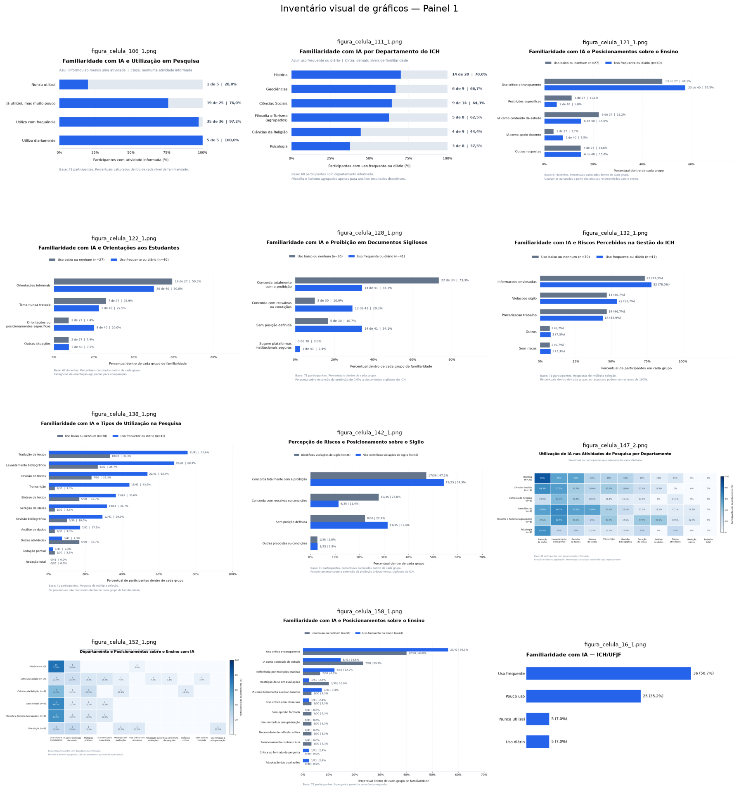
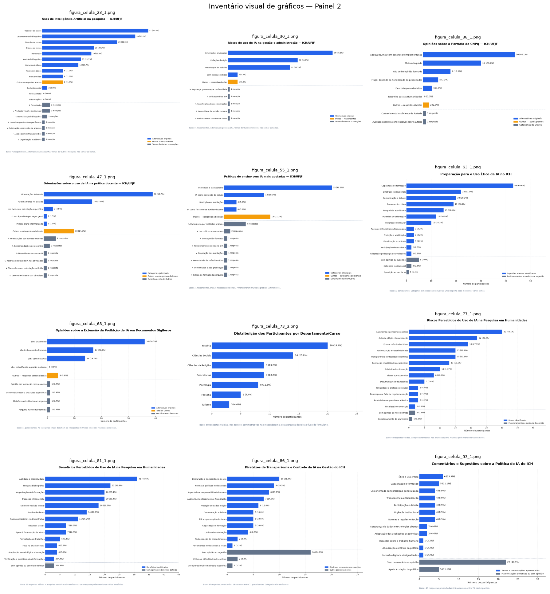
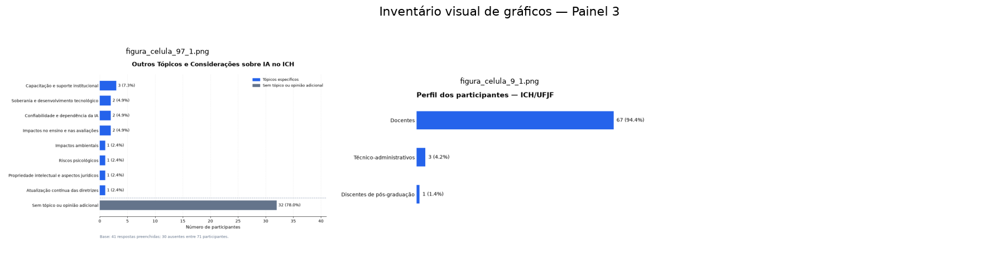

# Inteligência Artificial no ICH/UFJF

**Análise de dados do Formulário Consultivo para a Política de Inteligência Artificial da UFJF — perspectivas do Instituto de Ciências Humanas (ICH).**

## Sobre o projeto

Este repositório reúne o processo de exploração, tratamento e análise dos dados de um questionário sobre o uso de inteligência artificial no ambiente acadêmico do Instituto de Ciências Humanas da Universidade Federal de Juiz de Fora (UFJF).

O trabalho busca compreender como a IA é utilizada na pesquisa e no ensino, quais benefícios e riscos são percebidos pelos participantes e que orientações podem contribuir para um uso crítico, ético e responsável dessas ferramentas.

**Estado atual:** os notebooks de análise e os gráficos estão disponíveis. O **dashboard interativo em HTML ainda não foi incluído** e será publicado em uma atualização futura.

## Objetivos

- Explorar e organizar as respostas do questionário.
- Identificar inconsistências, valores ausentes e registros de teste.
- Padronizar os dados e produzir indicadores descritivos.
- Analisar familiaridade com IA, usos na pesquisa, práticas de ensino, riscos e propostas de orientação institucional.
- Comparar respostas entre departamentos e níveis de familiaridade, respeitando os limites de cada grupo.
- Disponibilizar gráficos que facilitem a interpretação e a apresentação dos resultados.

## Estrutura do repositório

```text
.
├── .gitignore
├── requirements.txt
├── notebooks/
│   ├── 01_exploracao_inicial.ipynb
│   └── 02_analise_indicadores.ipynb
└── resultados/
    └── graficos/
        └── ... (gráficos gerados nas análises)
```

> A organização acima segue os caminhos utilizados nos notebooks para os gráficos. Se a pasta de imagens estiver publicada diretamente como `graficos/`, o conteúdo é o mesmo: visualizações produzidas durante a análise. O dashboard HTML não faz parte da estrutura atual.

### `01_exploracao_inicial.ipynb`

Primeira etapa do projeto, responsável por compreender e preparar a base de dados:

- Leitura inicial da planilha exportada do formulário.
- Inspeção das dimensões, tipos de dados e valores ausentes.
- Identificação de possíveis duplicidades e de uma submissão de teste.
- Remoção do registro de teste e padronização de colunas e categorias.
- Tratamento de perguntas de múltipla escolha e respostas abertas.
- Preparação de uma base analítica e de arquivos auxiliares para as etapas seguintes.

### `02_analise_indicadores.ipynb`

Segunda etapa, dedicada à produção e à interpretação dos resultados:

- Perfil dos participantes e familiaridade com ferramentas de IA.
- Atividades de pesquisa apoiadas por IA.
- Benefícios e riscos percebidos na pesquisa.
- Distribuição e comparações por departamento.
- Orientações docentes e práticas de ensino.
- Questões de gestão, sigilo e uso ético da IA.
- Opiniões e propostas relacionadas a diretrizes institucionais.
- Cruzamentos entre indicadores, gráficos e organização de resultados.

### Gráficos

Os gráficos gerados nos notebooks permitem consultar as distribuições de respostas, comparar categorias e observar diferenças descritivas entre grupos. As visualizações estão organizadas por temas, como perfil, pesquisa, departamentos, ensino, gestão e sigilo e política institucional.

### Galeria de gráficos — painéis compilados

Para facilitar a consulta aos resultados, os gráficos também foram reunidos em **três painéis visuais**. Cada painel apresenta várias visualizações lado a lado, preservando títulos, legendas e bases de cálculo para apoiar a leitura comparativa. Clique na imagem para abri-la em tamanho maior no GitHub.

#### Painel 1 — Familiaridade, departamentos e cruzamentos

[](resultados/graficos/figura_celula_170_2.png)

Reúne cruzamentos da familiaridade com IA com atividades de pesquisa, orientações e práticas de ensino, riscos de gestão, sigilo e distribuição por departamentos.

#### Painel 2 — Pesquisa, ensino, riscos e propostas institucionais

[](resultados/graficos/figura_celula_170_4.png)

Apresenta as análises gerais sobre uso da IA na pesquisa, benefícios, riscos, orientações no ensino, sigilo, propostas para uso ético e contribuições para uma política institucional.

#### Painel 3 — Perfil e considerações adicionais

[](resultados/graficos/figura_celula_170_6.png)

Complementa a visão geral com o perfil dos participantes e os tópicos adicionais apontados no questionário.

> **Nota metodológica:** os painéis são compilações visuais dos gráficos, não novas análises. As porcentagens podem utilizar bases diferentes conforme a pergunta, e categorias de respostas múltiplas não necessariamente somam 100%. Para ver cada gráfico em separado, consulte os demais arquivos da pasta `graficos/`.

## Metodologia e tratamento dos dados

A análise parte das respostas ao formulário consultivo. A base original continha **72 registros e 18 colunas**. Após a identificação e a exclusão de **uma submissão de teste**, permaneceram **71 respostas válidas**.

As questões fechadas foram contabilizadas por frequências absolutas e relativas. Alternativas de múltipla seleção foram tratadas individualmente, enquanto respostas abertas foram classificadas em categorias temáticas para viabilizar sua análise.

**Atenção às bases de cálculo:** nem todas as perguntas foram respondidas pelo mesmo número de participantes. Por exemplo, a análise geral utiliza até 71 respostas; algumas perguntas de pesquisa têm 68 respostas válidas, e a questão de orientação docente considera 67 docentes. Por isso, os percentuais devem ser interpretados conforme a base específica de cada pergunta. Em questões de múltipla seleção ou com categorias temáticas não exclusivas, a soma dos percentuais pode ultrapassar 100%.

## Tecnologias utilizadas

- **Python** — processamento e análise dos dados.
- **Pandas** — leitura, limpeza, organização e agregação das respostas.
- **NumPy** — apoio a cálculos e manipulação de dados.
- **Matplotlib** — produção de gráficos.
- **Jupyter Notebook** — desenvolvimento e documentação das etapas analíticas.
- **Pillow (PIL)** — apoio ao tratamento e à organização de imagens geradas.

As dependências do ambiente estão relacionadas em `requirements.txt`.

## Como consultar ou executar

### 1. Clonar o repositório

```bash
git clone <URL-DO-REPOSITORIO>
cd <NOME-DO-REPOSITORIO>
```

Substitua os campos entre sinais de menor/maior pelos dados reais do repositório.

### 2. Criar um ambiente virtual (recomendado)

**Windows (PowerShell):**

```powershell
python -m venv .venv
.\.venv\Scripts\Activate.ps1
```

**Linux/macOS:**

```bash
python3 -m venv .venv
source .venv/bin/activate
```

### 3. Instalar as dependências

```bash
python -m pip install -r requirements.txt
```

### 4. Acessar os notebooks

Abra a pasta `notebooks/` pelo VS Code, Jupyter Notebook ou outro ambiente compatível com arquivos `.ipynb`. Para acompanhar o trabalho, comece por `01_exploracao_inicial.ipynb` e depois consulte `02_analise_indicadores.ipynb`.

**Importante:** os notebooks fazem referência a arquivos de dados e mapeamentos usados na análise, como `data/ia.csv`, `data/mapeamentos_categorias.json` e arquivos CSV derivados. Esses arquivos **não estão incluídos na estrutura pública descrita neste README**. Assim, é possível consultar o código, as explicações, as saídas já registradas nos notebooks e os gráficos publicados, mas **a reexecução completa das células depende do acesso autorizado aos dados auxiliares originais**. Também é necessário preservar os caminhos esperados pelos notebooks.

## Principais resultados observados

A análise indica que a inteligência artificial já faz parte de atividades acadêmicas no ICH, sobretudo em tarefas de apoio à pesquisa, como tradução, levantamento bibliográfico e revisão textual. Também aparecem diferenças nos níveis de familiaridade com as ferramentas, preocupações com autoria, pensamento crítico, confiabilidade e sigilo, além de demandas por formação e orientações institucionais.

Esses resultados são **descritivos**: representam as respostas da comunidade consultada, não demonstram relações de causa e efeito e não devem ser generalizados automaticamente para toda a instituição.

## Próxima atualização: dashboard HTML

A próxima etapa do repositório será a inclusão de um **dashboard interativo em HTML**, destinado a reunir os indicadores e gráficos em uma interface navegável. A intenção é facilitar a exploração dos resultados por tema, mantendo os valores e as bases de cálculo usados nos notebooks.

**O dashboard ainda não está disponível neste repositório.** Até sua publicação, os notebooks e os gráficos são os materiais principais para consulta.

## Observações sobre os dados

O projeto apresenta resultados agregados e evita a divulgação de informações pessoais dos participantes. Qualquer reprocessamento ou publicação de dados individuais deve observar as regras aplicáveis de privacidade, autorização e uso acadêmico.

Este é um trabalho de análise e apoio à discussão acadêmica. **Não representa uma política institucional de IA aprovada pela UFJF.**

---

**Instituto de Ciências Humanas — Universidade Federal de Juiz de Fora (ICH/UFJF) | 2026**
